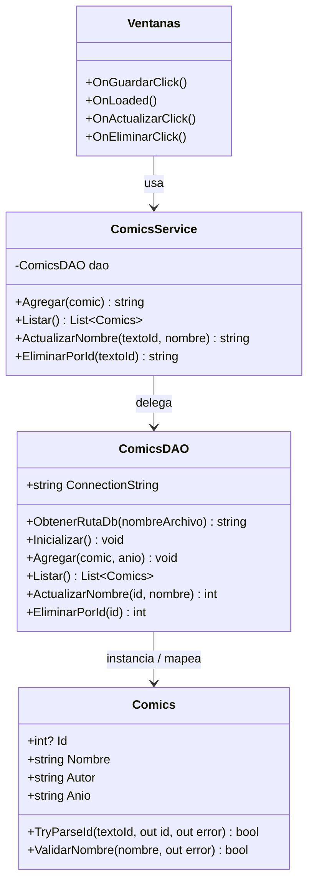

# BibliotecaHistorieta

Aplicación de escritorio desarrollada en **C#** y **.NET 8.0** con **Avalonia UI** y persistencia local en **SQLite** mediante **ADO.NET** (`Microsoft.Data.Sqlite`), organizada bajo una arquitectura por capas (Vista / Ventanas -> Servicio -> Modelo ->DAO ).

---

## 6.1. Información general

* **Nombre del proyecto:** `BibliotecaHistorieta`
* **Autor:** Alan Padilla Alvear
* **Descripción del software:** Aplicación de escritorio para gestionar un catálogo de historietas/cómics de forma local, permitiendo registrar nuevos títulos, consultar la lista almacenada, modificar el nombre de un registro existente por su ID y eliminar registros por ID.
* **Problema o necesidad que resuelve:** Centralizar y organizar el registro de historietas en una base de datos local ligera sin requerir un servidor de base de datos externo, evitando errores por entradas inválidas mediante validaciones previas.
* **Objetivo principal de la aplicación:** Implementar un sistema CRUD funcional y estructurado en capas para administrar historietas (`Id`, `Nombre`, `Autor`, `Anio`) con interfaz gráfica en Avalonia UI y persistencia en SQLite.

---

## 6.2. Funcionalidades

* **Registrar cómic (`Agregar`):** Permite capturar nombre, autor y año de publicación, validar los datos antes de guardar, mostrar mensajes de confirmación o error en la interfaz y limpiar los campos al registrar correctamente.
* **Listar cómics (`Listar`):** Carga automáticamente los registros de la base de datos al abrir la vista (sin depender de un botón manual) y los presenta en un `ListBox` con encabezados de columnas.
* **Actualizar nombre (`Actualizar`):** Permite indicar el `ID` del cómic y su nuevo `Nombre`, validando el identificador y el texto antes de actualizar el registro en la base de datos e informando si el ID existe o no.
* **Eliminar cómic (`Eliminar`):** Permite eliminar un registro indicando su `ID`, validando el formato numérico y mostrando retroalimentación si el registro fue eliminado o no encontrado.

---

## 6.3. Tecnologías utilizadas

* **Plataforma:** .NET 8.0
* **Lenguaje:** C#
* **Interfaz gráfica:** Avalonia UI (XAML / `.axaml` y code-behind `.axaml.cs`)
* **Acceso a datos:** ADO.NET con `Microsoft.Data.Sqlite` (`SqliteConnection`, `SqliteCommand`, `SqliteDataReader`)
* **Base de datos:** SQLite (`biblioteca.db`)
* **Control de versiones:** Git / GitHub

---

## 6.4. Estructura del proyecto

```text
BibliotecaHistorieta/
├── Models/
│   └── Comics.cs
├── Data/
│   └── ComicsDAO.cs
├── Services/
│   └── ComicsService.cs
├── Ventanas/
│   ├── Agregar.axaml
│   ├── Agregar.axaml.cs
│   ├── Listar.axaml
│   ├── Listar.axaml.cs
│   ├── Actualizar.axaml
│   ├── Actualizar.axaml.cs
│   ├── Eliminar.axaml
│   └── Eliminar.axaml.cs
├── MainWindow.axaml
├── MainWindow.axaml.cs
├── App.axaml
├── App.axaml.cs
├── BibliotecaHistorieta.csproj
└── README.md

```
# Arquitectura del Proyecto

## Clases principales y responsabilidades

- **Comics (`Models/Comics.cs`)**: Representa la entidad del dominio con las propiedades `Id`, `Nombre`, `Autor` y `Anio`, además de contener las reglas y validaciones de datos (como validación de ID numérico positivo y nombre obligatorio).
- **ComicsDAO (`Data/ComicsDAO.cs`)**: Encapsula la lógica de acceso a datos con SQLite. Resuelve la ruta del archivo de base de datos, crea la tabla si no existe (`Inicializar`) y ejecuta las sentencias SQL parametrizadas (`INSERT`, `SELECT`, `UPDATE`, `DELETE`).
- **ComicsService (`Services/ComicsService.cs`)**: Actúa como capa intermedia entre las ventanas y `ComicsDAO`. Coordina validaciones, conversiones seguras y respuestas de éxito o error hacia la interfaz.
- **Ventanas (`Ventanas/*.axaml` / `.axaml.cs` y `MainWindow`)**: Gestionan la interacción con el usuario, capturan entradas, disparan eventos de interfaz (como `Click` y `Loaded`) y muestran los mensajes o listados resultantes.

## Relación entre clases y conceptos de POO

- **Encapsulamiento**: Cada clase separa su responsabilidad (modelo/validaciones en `Comics`, SQLite en `ComicsDAO`, flujo/reglas en `ComicsService` y presentación en las ventanas).
- **Composición / Asociación**: Las ventanas utilizan una instancia de `ComicsService`, y `ComicsService` utiliza una instancia de `ComicsDAO` para delegar la persistencia.
- **Clases parciales (`partial class`)**: Las ventanas en C# se combinan con el código generado a partir de XAML en Avalonia.

## Diagrama de clases (resumen)


# Arquitectura del Proyecto

## Clases principales y responsabilidades

* **Comics (`Models/Comics.cs`)**: Representa la entidad del dominio con las propiedades `Id`, `Nombre`, `Autor` y `Anio`, además de contener las reglas y validaciones de datos (como validación de ID numérico positivo y nombre obligatorio).

* **ComicsDAO (`Data/ComicsDAO.cs`)**: Encapsula la lógica de acceso a datos con SQLite. Resuelve la ruta del archivo de base de datos, crea la tabla si no existe (`Inicializar`) y ejecuta las sentencias SQL parametrizadas (`INSERT`, `SELECT`, `UPDATE`, `DELETE`).

* **ComicsService (`Services/ComicsService.cs`)**: Actúa como capa intermedia entre las ventanas y `ComicsDAO`. Coordina validaciones, conversiones seguras y respuestas de éxito o error hacia la interfaz.

* **Ventanas (`Ventanas/*.axaml` / `.axaml.cs` y `MainWindow`)**: Gestionan la interacción con el usuario, capturan entradas, disparan eventos de interfaz (como `Click` y `Loaded`) y muestran los mensajes o listados resultantes.

## Relación entre clases y conceptos de POO

* **Encapsulamiento**: Cada clase separa su responsabilidad (modelo/validaciones en `Comics`, SQLite en `ComicsDAO`, flujo/reglas en `ComicsService` y presentación en las ventanas).

* **Composición / Asociación**: Las ventanas utilizan una instancia de `ComicsService`, y `ComicsService` utiliza una instancia de `ComicsDAO` para delegar la persistencia.

* **Clases parciales (`partial class`)**: Las ventanas en C# se combinan con el código generado a partir de XAML en Avalonia.

## Diagrama de clases (resumen)

```
classDiagram
    class Comics {
        +int? Id
        +string Nombre
        +string Autor
        +string Anio
        +TryParseId(textoId, out id, out error) bool
        +ValidarNombre(nombre, out error) bool
    }

    class ComicsService {
        -ComicsDAO dao
        +Agregar(comic) string
        +Listar() List~Comics~
        +ActualizarNombre(textoId, nombre) string
        +EliminarPorId(textoId) string
    }

    class ComicsDAO {
        +string ConnectionString
        +ObtenerRutaDb(nombreArchivo) string
        +Inicializar() void
        +Agregar(comic, anio) void
        +Listar() List~Comics~
        +ActualizarNombre(id, nombre) int
        +EliminarPorId(id) int
    }

    class Ventanas {
        +OnGuardarClick()
        +OnLoaded()
        +OnActualizarClick()
        +OnEliminarClick()
    }

    Ventanas --> ComicsService : usa
    ComicsService --> ComicsDAO : delega
    ComicsDAO --> Comics : instancia / mapea

```

## 6.5. Instalación de dependencias

1. **Instalar el SDK de .NET 8.0**: Descarga e instala el SDK de .NET 8.0 desde el sitio oficial de Microsoft y verifica en terminal:

   ```bash
   dotnet --version
   ```

2. **Clonar el repositorio desde GitHub**:

   ```bash
   git clone <URL_DEL_REPOSITORIO>
   cd BibliotecaHistorieta
   ```

   *(Si el archivo `.csproj` está dentro de una subcarpeta, entra a esa carpeta antes de ejecutar los comandos de `dotnet`.)*

3. **Restaurar dependencias NuGet (`Microsoft.Data.Sqlite`, Avalonia UI, etc.)**:

   ```bash
   dotnet restore
   ```

4. **Configuración adicional**: No se requiere instalar un servidor de base de datos externo ni configurar credenciales manualmente, ya que SQLite se maneja mediante archivo local.

## 6.6. Ejecución del programa

Desde la carpeta donde se encuentra `BibliotecaHistorieta.csproj`:

```bash
dotnet restore
dotnet run
```

Al ejecutar `dotnet run`, el proyecto compila y abre la ventana principal de la aplicación.

## 6.7. Base de datos

* **Información almacenada**: Almacena los registros de historietas con su identificador autoincremental, nombre, autor y año.
* **Tabla y campos principales (`Comics`)**:
  * `Id`: `INTEGER PRIMARY KEY AUTOINCREMENT`
  * `Nombre`: `TEXT NOT NULL`
  * `Autor`: `TEXT NOT NULL`
  * `Anio`: `INTEGER NOT NULL`
* **Conexión con SQLite**: Se establece mediante `SqliteConnection` usando la cadena `Data Source=...` generada a partir de `AppContext.BaseDirectory` y el archivo `biblioteca.db`.
* **Operaciones CRUD**: Se realizan en `ComicsDAO` mediante consultas parametrizadas (`@Nombre`, `@Autor`, `@Anio`, `@Id`) con `SqliteCommand`:
  * **Create**: `INSERT INTO Comics (Nombre, Autor, Anio) VALUES (@Nombre, @Autor, @Anio);`
  * **Read**: `SELECT Id, Nombre, Autor, Anio FROM Comics ORDER BY Id DESC;`
  * **Update**: `UPDATE Comics SET Nombre = @Nombre WHERE Id = @Id;`
  * **Delete**: `DELETE FROM Comics WHERE Id = @Id;`
* **Creación e inicialización**: La base de datos y la tabla `Comics` se crean automáticamente mediante `CREATE TABLE IF NOT EXISTS` en `ComicsDAO.Inicializar()` (y el directorio base se asegura con `Directory.CreateDirectory`), sin necesidad de crear el archivo ni la tabla a mano antes de ejecutar.

## 6.8. Evidencias de funcionamiento

> Reemplaza las rutas de imagen por tus capturas reales antes de subir el repositorio.

* **Registro de cómic**: 
  * **Explicación**: Se ingresan los datos de un cómic y se presiona guardar; se muestra el mensaje de confirmación y el registro queda almacenado.
* **Listado automático**: 
  * **Explicación**: Al abrir la vista de listar, se cargan automáticamente los registros desde SQLite y se visualizan con su encabezado.
* **Actualización por ID**: 
  * **Explicación**: Se ingresa un ID existente y el nuevo nombre; se actualiza el registro y se muestra el mensaje correspondiente (o aviso si el ID no existe).
* **Eliminación por ID**: 
  * **Explicación**: Se ingresa un ID para eliminar y se confirma la eliminación o el mensaje de registro no encontrado.

## 6.9. Problemas encontrados y soluciones

* **Coincidencia de `x:Class`, `namespace` y `InitializeComponent` en Avalonia**: Al mover o crear ventanas en carpetas, un desajuste entre `x:Class` en el `.axaml` y el `namespace` / nombre de clase en el `.axaml.cs` impedía generar `InitializeComponent` y los nombres de controles. Se resolvió alineando exactamente `x:Class`, `namespace`, clase parcial y directivas `using`.
* **Resolución de propiedades en `DataTemplate` (`AVLN2000`)**: Al enlazar propiedades de `Comics` dentro de la plantilla del `ListBox`, el compilador de Avalonia reportaba `AVLN2000`. Se solucionó declarando el namespace del modelo en XAML y asignando `x:DataType="models:Comics"` en el `DataTemplate`.
* **Validación segura de entradas numéricas**: Para evitar excepciones al convertir texto a entero desde los cuadros de texto, se implementó validación previa y conversión segura con `int.TryParse`.
